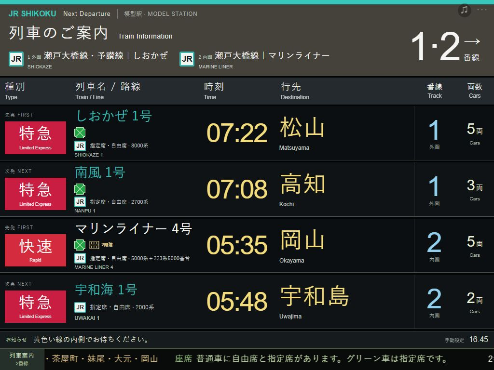

# Model Station · N Gauge Web Platform

[简体中文](README.md) · [日本語](README.ja.md) · **English**

[Live demo](https://n-gauge-platform-board.clear-seal-8717.chatgpt.site/) · [Local deployment guide](docs/DEPLOYMENT.en.md) · [Architecture](docs/ARCHITECTURE.md) · [MIT license](LICENSE)

A Japanese railway departure-board simulator for N gauge layouts and iPad displays. It uses a JR East inspired overall layout with separate branding, service types and equipment indicators for private railways and special trains. Built with plain HTML, CSS and JavaScript; no framework or frontend dependencies are required.




V13 adds Shikoku: ten presets and 154 dated references across Shiokaze, Ishizuchi, Nanpu, Shimanto, Uwakai, Ashizuri, Uzushio and Marine Liner. Shared service references do not guarantee the assigned fleet. Marine Liner No. 2 is excluded from the 5000-series preset. Eighteen product records were added; five are explicitly marked announced. Large-text reading is available in settings and the model directory; this device-local preference is separate from train backup files. See [V13 research](docs/NSCALE-V13-RESEARCH.md).

## Features

- **Two model platforms and four departures:** platform 1 is the outer R315 loop; platform 2 is the inner R282 loop. Each has a first and next departure.
- **247 vehicle/service presets:** choose region → category → route → vehicle. Regions cover eastern Japan, western Japan, Hokkaido, Tokai, Kyushu and Shikoku; categories include Shinkansen, limited express, commuter and private/local transport.
- **Manual editing:** train name, service number, origin, destination, departure time and model formations from 1–30 cars. Open settings through the discreet `···` control at the top right.
- **18 equipment indicators and 27 brands:** Green Car, GranClass, u-seat, PREMIUM CAR, PRiVACE, Hinotori, Shimakaze, Saphir Odoriko and others. Some use official artwork; others use text or schematic indicators.
- **Scrolling train information:** stops and non-reserved/reserved/Green seating for the next departure. Choose a fixed row, model clock, speed, pause or custom text.
- **LCD/LED appearance:** Japanese/English board information, optional dot texture, landscape/portrait layouts, browser-local persistence and JSON settings export.

## Matching N-scale models · V13

**608 product records covering 229 of 247 presets** (224 matching, 5 with explicitly different reference versions only). The remaining 18 explain unresolved evidence. Ten makers are covered, and 72 presets offer multiple makers.


Open `···` → Train (列车) → platform and first/next departure → **对应N比例车型**. Quick vehicle search accepts series, train names and routes, including full-width letters/numbers and kana variants. Selection changes only the row being edited.

There are 89 verified basic/add-on recipes with copyable part-number lists. Diagrams group cars by retail package, not actual train order, and leave your model car count unchanged. The directory can show only vehicles with recipes and share a filtered search link.

603 records have official codes; 5 verified products without a confirmed complete-set code use their product name and official source instead of an invented number. Assembled, static and kit products are labelled separately. Explicit minimum-radius specifications and conditional curve compatibility are kept distinct. Historical/announced products are included; this is not a stock listing. Missing entries do not imply no model exists. See [matching and maintenance notes](NSCALE-MODELS.md).

V12 adds package-type and explicitly documented R282/R315 filters, removable filter chips and a deduplicated CSV export of all filtered pages. Under Display (屏幕) → Settings backup (设置备份与迁移), preview and import a settings JSON file, then restore the pre-import snapshot within the same page if needed. This supports desktop-to-iPad transfers.

## Timetable scope

This release is **V13: 247 presets and 17,184 reference records**, frozen to **Sunday, 25 October 2026, Japan Standard Time (UTC+9)**. It contains the complete published day within the stated origin, direction and service scope for 243 presets; 0 remain partial, and 4 cover Sunday-inactive or historical services. Different vehicle presets can share the same real departure: the record total is not a count of unique trains. Data is neither live nor updated automatically the following day.

Coverage completeness and operating-date verification are separate: 11,402 records were checked for the specified day, 5,528 use official weekend/holiday tables, 230 use daily references, and 20 still require operating-calendar confirmation. Weekday-only and discontinued services remain labelled. Current official Ginza/Marunouchi data replaces the older samples.

The discreet settings drawer supports **origin, direction, time-period and keyword filters**, with matching and total counts. Filtering alone keeps the current service unchanged. Selecting a reference still allows a custom fixed time. The source audit renders 50 records per page, and after-midnight departures retain the source's 24-hour-plus notation.

Real services may use mixed fleets; individual vehicle assignments are not guaranteed. Model lengths and platforms are independent of real formations, seat-car numbers and station tracks. Full stopping patterns apply only to matching stored routes and services; editing a number does not fetch another train.

See [TIMETABLES.md](TIMETABLES.md), [special-display research](SPECIAL-DISPLAYS.md) and [scrolling research](SCROLL-RESEARCH.md). Edit [data/timetables.json](data/timetables.json), then run `npm run build:timetable` and `npm test` to regenerate and verify the browser data (detailed research is primarily in Chinese).

## Whole-board themes and arrival announcements · V8

Open `···` → display options → whole-board style to choose 12 representative themes: the six JR companies, Kintetsu, Hankyu, Keihan, Nankai, Hanshin and Tokyo Metro. Column order, headings, direction panels, platform blocks and colors change together, while services, brands and model formations remain intact. These are adaptations of specific display examples, not universal official templates.

Click a train name or its arrival-announcement button to play device-provided Japanese speech synthesis. Representative-station mappings cover 159 routes and 247 presets, with 17 vehicle exceptions. Audio is an adapted script, not an original station recording or cloned announcer. Representative stations do not change reference times or replace model platform numbers with real ones.

Enable sound and the automatic option to compare Japan's current time with the four displayed fixed times. A simultaneous batch plays outer first → outer next → inner first → inner next, waiting for each announcement to finish. Each row/time is automatically queued once per Japan calendar day. The departure time is a model-arrival trigger, not live train-position information. Stop clears the queue; manual playback can repeat.

iPad/Safari needs another explicit tap after reload. Background pages, switching apps and screen locking may suspend playback; missed minutes are not replayed. Voice availability and sound quality depend on the device. See [sources and limitations](DISPLAY-AUDIO-RESEARCH.md).

## Quick start

Install Python 3. Downloading a ZIP avoids needing Git. Run these commands from the repository root, containing both `README.md` and `dist/`:

```sh
git clone https://github.com/sakual123/N-gauge-web-platform.git
cd N-gauge-web-platform
python -m http.server 8769 --bind 127.0.0.1 --directory dist
```

Use `py` with the Windows Python launcher, or usually `python3` on Linux/macOS. Open **http://127.0.0.1:8769/** on the same computer. Press `Ctrl+C` to stop.

For an iPad, change the bind address to `0.0.0.0`, connect to the same LAN and open `http://SERVER_LAN_IP:8769/` in Safari. The [English deployment guide](docs/DEPLOYMENT.en.md) covers installation, finding the IP, troubleshooting and Linux startup.

## Controls and persistence

1. Open `···` and choose platform 1/2, region, category, route and vehicle.
2. Select an official reference departure or edit the time, number, destination and car count. Changes save automatically in the current browser.
3. Use `滚动停站与座席` for stops/seats and `底部滚动提示` for the target departure, clock, speed and pause.
4. Use `导出设置备份` to export JSON. There is currently no graphical JSON import button.

Existing rows and custom model formations are retained. `四行套用默认参考班次` and loading a scene change the four current rows. Storage belongs to each site origin: changing IP, port, protocol or device does not move settings automatically. Adding the page to the iPad Home Screen does not cache it for offline use; this version has no Service Worker.

Board information is mainly Japanese/English; the editor is currently Chinese. Multilingual documentation does not add a three-language UI switch.

## Development

Use Node.js 22 or a newer supported LTS for checks. No `npm install` is needed:

```sh
npm test
```

Alternatively run `node tools/check-timetable.cjs`, `node tools/check-special.cjs`, `node tools/check-ticker.cjs` and `node tools/check-arrivals.cjs`. GitHub Actions runs the same checks on pushes and pull requests.

`dist/` is the static website. `catalog*.js` defines regions/routes/vehicles; `timetable-*.js` provides reference departures; `special-services.js` and `service-ui.js` handle brands/equipment; `journey-*.js` handles stops, seats and scrolling. See the [architecture notes](docs/ARCHITECTURE.md).

This is currently a standalone web frontend. OpenCV/YOLO recognition and an LVGL hardware display client are not implemented.

## Contributing and licensing

Issues and pull requests are welcome. Timetable corrections should include the official source, applicable date, origin and direction, with uncertain operating dates and mixed fleets clearly identified. Run the checks before submitting and verify UI changes at iPad landscape and portrait sizes.

Original code is released under the [MIT License](LICENSE). Third-party trademarks, service names and official artwork are excluded from this project's MIT grant; see [THIRD_PARTY_NOTICES.md](THIRD_PARTY_NOTICES.md) and the asset source list. This is an independent hobby project, without railway-operator affiliation or endorsement.
