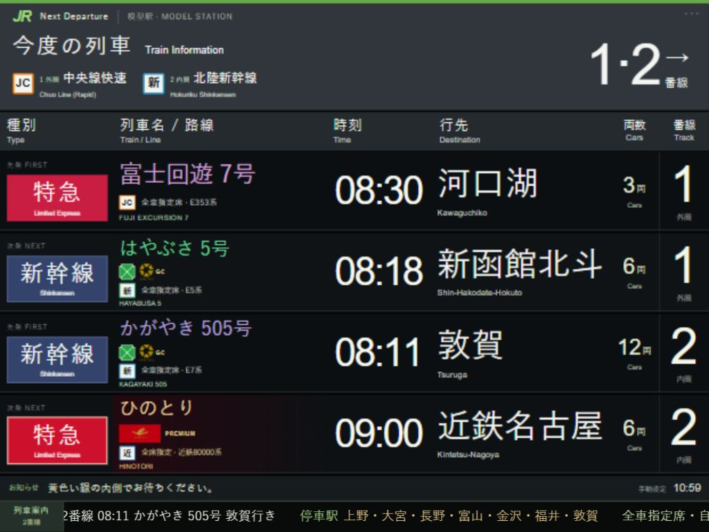

# 模型駅 · N Gauge Web Platform

[简体中文](README.md) · **日本語** · [English](README.en.md)

[デモ](https://n-gauge-platform-board.clear-seal-8717.chatgpt.site/) · [ローカル導入ガイド](docs/DEPLOYMENT.ja.md) · [構成](docs/ARCHITECTURE.md) · [MIT ライセンス](LICENSE)

N ゲージのレイアウトや iPad に表示する、日本の鉄道駅の発車標シミュレーターです。JR 東日本風の表示を基本に、私鉄や特別な列車の種別・ブランド・設備表示を個別に設定できます。HTML / CSS / JavaScript のみで動作し、フレームワークやフロントエンド依存パッケージは不要です。



## 主な機能

- **2 つの模型ホーム、4 行の列車情報**：1 番線は外側 R315、2 番線は内側 R282。それぞれ先発・次発を表示します。
- **237 の車両・列車プリセット**：地域 → 分類 → 路線 → 車両の順に選択。東日本・西日本・北海道・東海・九州、新幹線・特急・通勤・私鉄／地域交通に対応します。
- **手動編集**：列車名、号数、発駅、行先、発車時刻、1～30 両の模型編成。右上の控えめな `···` から設定します。
- **18 種類の設備と 27 ブランド**：グリーン車、GranClass、u-seat、PREMIUM CAR、PRiVACE、ひのとり、しまかぜ、サフィール踊り子など。公式画像を使用するものと、文字・模式アイコンによるものがあります。
- **下部スクロール案内**：次の発車列車の停車駅や自由席・指定席・グリーン車を案内。対象固定、模型時刻、速度、一時停止、手入力に対応します。
- **LCD／LED 表示**：日英表示、ドット風表現、縦横画面対応、ブラウザー内保存、JSON 設定の書き出し。

## 時刻表データの範囲

公開版は **V7、237 プリセット、17,030 件の参考データ**です。基準日は **2026 年 10 月 25 日（日）、日本時間 JST（UTC+9）**に固定されています。233 プリセットで明記した発駅・方向・種別の終日分を収録し、0 件は未完、4 件は日曜運休または運転終了後の資料です。同じ実列車を複数形式で参照する場合があり、総数は実列車の重複なし本数ではありません。リアルタイム情報ではなく翌日に自動更新もしません。

収録範囲の完全性と運転日の確認は別です。指定日確認 11,248 件、公式土休日 5,528 件、毎日参考 230 件、運転日要確認 20 件を区別し、平日のみ・歴史資料も明記します。銀座線・丸ノ内線の旧資料は現行公式情報に置き換えました。

右上の設定で**発駅・方向・時間帯・キーワード**から便を絞り込めます。絞り込みだけでは表示中の便を変更せず、選択後も固定時刻を編集できます。出典一覧は 1 ページ 50 件です。日付をまたぐ末便は原表の24時表記も保存します。

同一路線で形式が共用されるため各便の配車は保証しません。模型両数・模型番線は実車編成・座席号車・実駅の番線と独立しています。号数・方向・種別が一致しない便に別便の全停車駅を流用しません。

資料は [TIMETABLES.md](TIMETABLES.md)、[特殊表示](SPECIAL-DISPLAYS.md)、[スクロール案内](SCROLL-RESEARCH.md) にあります。編集可能な [時刻データ](data/timetables.json) を更新し、`npm run build:timetable` → `npm test` で再生成・検証できます（詳細資料は中国語中心）。

## すぐに使う

Python 3 を用意します。ZIP で入手すれば Git のインストールは不要です。`README.md` と `dist/` があるリポジトリ直下で実行してください。

```sh
git clone https://github.com/sakual123/N-gauge-web-platform.git
cd N-gauge-web-platform
python -m http.server 8769 --bind 127.0.0.1 --directory dist
```

Windows では `py`、Linux／macOS では通常 `python3` が使えます。同じ端末のブラウザーで **http://127.0.0.1:8769/** を開きます。終了は `Ctrl+C` です。

iPad からは `--bind 0.0.0.0` に変更し、同一 LAN の Safari で `http://サーバーのLAN内IP:8769/` を開きます。インストール、IP の確認、トラブル対処、Linux の自動起動は [日本語の導入ガイド](docs/DEPLOYMENT.ja.md) を参照してください。

## 設定と保存

1. 右上の `···` を開き、1／2 番線、地域、分類、路線、車両を選びます。
2. 公式参考便を選ぶか、発車時刻・号数・行先・両数を編集します。変更は現在のブラウザーに自動保存されます。
3. `滚动停站与座席` で停車駅・座席案内、`底部滚动提示` で対象列車・時計・速度・一時停止を設定します。
4. `导出设置备份` で JSON を書き出せます。現在、GUI による JSON 読み込みボタンはありません。

既存の 4 行と模型編成は引き継ぎます。`四行套用默认参考班次` やシーン読込は表示中の 4 行を変更します。保存先はアクセス元のアドレスごとに異なり、IP・ポート・プロトコル・端末を変更しても自動同期されません。ホーム画面への追加だけではオフライン保存されません。本版に Service Worker はありません。

発車標は主に日本語・英語ですが、編集画面は現在中国語です。三言語の文書は UI の言語切替機能を意味しません。

## 開発

チェックには Node.js 22 またはそれ以降のサポート対象 LTS を使用します。`npm install` は不要です。

```sh
npm test
```

または `node tools/check-timetable.cjs`、`node tools/check-special.cjs`、`node tools/check-ticker.cjs` を実行します。GitHub Actions でも push／pull request 時に同じチェックを実行します。

`dist/` がそのまま公開可能な静的サイトです。`catalog*.js` が車両と路線、`timetable-*.js` が参考便、`special-services.js` と `service-ui.js` がブランドと設備、`journey-*.js` が停車駅・座席・スクロールを担当します。詳細は [構成説明](docs/ARCHITECTURE.md) を参照してください。

現在は独立した Web フロントエンドです。OpenCV／YOLO 認識や LVGL ハードウェア側は未実装です。

## 貢献とライセンス

Issue と Pull Request を歓迎します。時刻の変更には公式出典、適用日、発駅、方向を添え、運転日未確認や車種共用を区別してください。提出前にチェックを実行し、UI は iPad 相当の縦横画面で確認してください。

オリジナルコードは [MIT License](LICENSE) です。鉄道会社の商標・サービス名・公式図案などの第三者素材は、この MIT 許諾に含まれません。[THIRD_PARTY_NOTICES.md](THIRD_PARTY_NOTICES.md) と素材の出典一覧を確認してください。本プロジェクトは鉄道事業者の公式作品ではなく、提携や承認を示すものでもありません。
