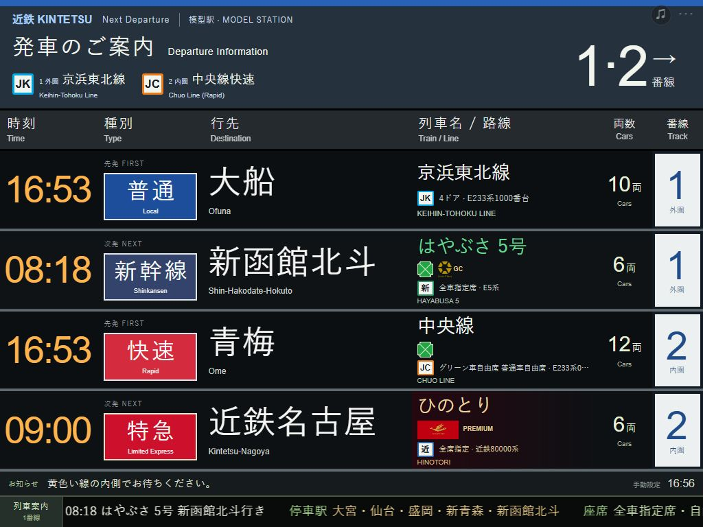
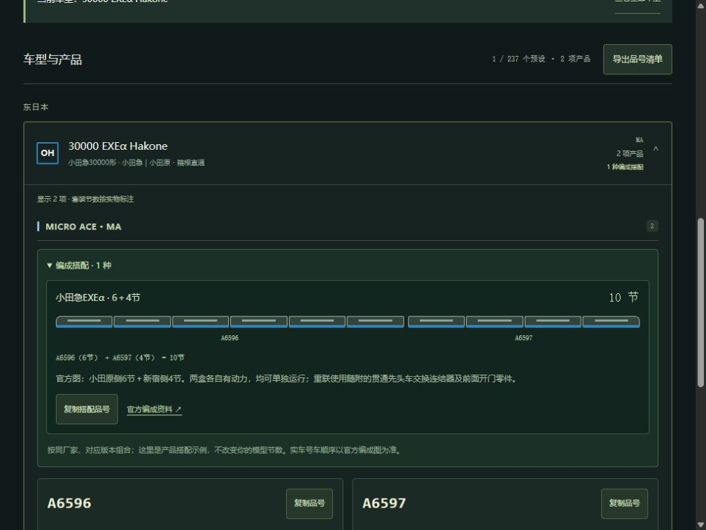

# 模型駅 · N Gauge Web Platform

**简体中文** · [日本語](README.ja.md) · [English](README.en.md)

[在线体验](https://n-gauge-platform-board.clear-seal-8717.chatgpt.site/) · [本地部署教材](docs/DEPLOYMENT.zh-CN.md) · [结构说明](docs/ARCHITECTURE.md) · [MIT 许可](LICENSE)

面向 N 比例铁路模型和 iPad 的日本铁路站台发车标模拟器。以 JR 东日本风格为主体，为私铁和特殊列车提供独立的品牌、种别和设备标识。纯 HTML / CSS / JavaScript，无框架，无需安装前端依赖。



## 功能

- **两个模型站台、四行班次**：1 站台为外圈 R315，2 站台为内圈 R282，各有先发和次发。
- **237 个车辆／服务预设**：按地区 → 类型 → 线路 → 车辆选择。地区包含东日本、西日本、北海道、东海、九州；类型包含新干线、特急、通勤、私铁／地方交通。
- **手动编辑**：车名、号数、出发站、行先、时间、1～30 节编组。右上角隐蔽的 `···` 打开设置。
- **18 类设备、27 个品牌**：Green Car、GranClass、u-seat、PREMIUM CAR、PRiVACE，以及火鸟、岛风、Saphir 踊子等的显示配置；部分品牌使用官方图案，其余使用文字或示意标识。
- **底部滚动案内**：最近待发列车的停站与自由席／指定席／Green 等座席说明，可固定班次、切换模型时钟、调速、暂停或自定义。
- **LCD／LED 外观**：日英主显示、点阵质感、横竖屏适配、浏览器保存和 JSON 设置导出。

## 对应N比例车型 · V12

已收录 **590项产品资料，覆盖221／237个预设**（216个有车型对应，5个仅有注明差异的版本参考）；其余16个保留具体待核实原因。共有10家厂商，72个预设可比较不同厂家。



右上角 `···` → **列车** → 选择站台和先发／次发 → **对应N比例车型**。也可点“快速找车”，输入系列、车名或线路跨地区选择，支持全角英数字与日文假名检索。选择只影响当前编辑的一班。

每家产品下的 **编成搭配** 列出官方资料核对的基本／增结组合，共88组，可复制整组品号。小车图按包装数量分组，不代表实际号车排列，也不改变你的模型节数。目录可筛选“仅看有编成搭配”，并复制当前查询链接。

585项有官方编号；另5项已确认商品但参考资料未列整套编号，按商品名和官方链接查询，不复制内部ID。完成品、静态模型、制作套件及历史版本分别标注；部分产品补充厂家明确的最小半径或带条件的曲线等级说明。

品号含历年及预告产品，不表示现货。未收录不等于没有模型；曲线等级不等于逐车最小半径，适用条件见备注。完整范围、匹配规则和维护方法见 [N比例品号说明](NSCALE-MODELS.md)。

V12可按基本／增结／单车及厂家明确的R282／R315数值筛选，逐项移除条件，导出当前结果全部页面的去重CSV品号清单。设置里的“屏幕”→“设置备份与迁移”支持导入JSON预览、应用和本页恢复导入前状态，便于电脑与iPad迁移。

## 班次资料的范围

当前是 **V12：237 个预设、17,030 条参考记录**，参考日固定为 **2026-10-25，星期日，日本时间 JST（UTC+9）**。已收齐 233 个预设各自所列站点、方向和种别的全天资料；0 个仍有缺口；另 4 个为周日无运行或历史服务。共用线路的车型可以引用同一实际班次，记录数不是独立列车数。页面不实时查询，也不会在次日自动换表。

运行日核对独立于完整度：指定日核对 11,248 条，官方土休日 5,528 条，每日参考 230 条，运行日仍需确认 20 条；工作日及已停运资料保留明确标记。新版东京 Metro 资料已替换旧的银座／丸之内样本。

右上角班次设置支持按**出发站、方向、时段、关键词**筛选，显示命中数与总数。筛选不改动当前班次，选中后仍可自定固定时间；全部来源核对页每页显示 50 条。午夜后末班保留原表 24:xx 证据。

具体系列可能混用，真实线路班次不保证由所选车型担当。模型节数独立于实车编组和座席号车；模型站台不表示实际车站番线。完整停站仅在已录入资料且号数、方向、种别仍匹配时使用；手填新号数不会联网查询。

详见 [逐项范围与来源](TIMETABLES.md)、[特殊显示考证](SPECIAL-DISPLAYS.md)、[滚动案内考证](SCROLL-RESEARCH.md)。编辑 [时刻数据](data/timetables.json) 后运行 `npm run build:timetable`，再运行 `npm test`。无需重新采集官网即可维护现有资料。

## 整屏主题与到站播报 · V8

右上角 `···` → **显示选项与场景 → 整屏站台风格**：JR东日本、西日本、东海、北海道、九州、四国，以及近铁、阪急、京阪、南海、阪神、东京Metro共12种参考主题。列顺序、表头、方向框、番线格和配色一起切换；保留四行班次、品牌、图标和模型编组。主题按具体车站/设备实例适配，不是每家全部站台的统一官方模板。

**点击列车名**或设置内“播报这班到站”即可手动播报。151条线路、237预设有代表站映射，另有17个车辆例外；广播采用设备日语语音合成，音色由设备提供，非原站录音或声优克隆。参考站决定模拟句式，不会把原参照时刻改成代表站时刻，也不会念真实车站番线。

在“到站播报”中先启用声音，再打开自动开关。系统按**日本实时时钟**匹配当前四行固定时刻，每天每行每个时刻仅自动入队一次；同一分钟按**外圈先发 → 外圈次发 → 内圈先发 → 内圈次发**串行播完。发车时刻在此作为模型到站触发点，不是实时列车位置。停止会清空队列，手动播报可以重复。

iPad/Safari刷新后需重新点一次启用；页面后台、切换App或锁屏时可能停播，错过的分钟不补播。日语声音列表可稍后加载；无声时检查系统音量和日语声音，选择另一音色或重新启用。站名与句式证据、官方/现场记录的区分见 [DISPLAY-AUDIO-RESEARCH.md](DISPLAY-AUDIO-RESEARCH.md)。

## 快速开始

安装 Python 3；使用 ZIP 下载源码不需要 Git。以下命令在仓库根目录运行，即同时包含 `README.md` 和 `dist/` 的目录。

```sh
git clone https://github.com/sakual123/N-gauge-web-platform.git
cd N-gauge-web-platform
python -m http.server 8769 --bind 127.0.0.1 --directory dist
```

Windows 的 Python 启动器可使用 `py`，Linux／macOS 通常使用 `python3`。本机打开 **http://127.0.0.1:8769/**。按 `Ctrl+C` 停止。

iPad 使用时，改为 `--bind 0.0.0.0`，连接同一局域网，在 Safari 打开 `http://服务器的局域网IP:8769/`。完整安装、查 IP、排错和 Linux 开机启动步骤见 [中文部署教材](docs/DEPLOYMENT.zh-CN.md)。

## 设置与保存

1. 点击右上角 `···`，选择 1／2 站台，再按地区、类型和线路选择车辆。
2. 选择官方参考班次，或修改固定出发时间、车次、行先和编组。修改自动保存在当前浏览器。
3. 在“滚动停站与座席”中设置停站和座席，在“底部滚动提示”中选择跟随班次、时钟、速度和暂停。
4. 需要备份时使用“导出设置备份”。当前版本没有图形化 JSON 导入按钮。

原有四行和自定义编组会保留；“四行套用默认参考班次”和载入场景会改变当前四行。浏览器保存按访问地址区分：换端口、IP、协议或设备不会自动带走设置。添加到 iPad 主屏幕不等于已经缓存为离线应用；本项目没有 Service Worker。

主显示以日文和英文为主，编辑器目前为中文；三语文档不代表编辑界面已经实现三语切换。

## 开发和文件

使用 Node.js 22 或更新的受支持 LTS 版本运行检查，不需要 `npm install`：

```sh
npm test
```

也可分别执行 `node tools/check-timetable.cjs`、`node tools/check-special.cjs`、`node tools/check-ticker.cjs`、`node tools/check-arrivals.cjs`。另外包括模型资料、快速找车与设置备份检查；GitHub Actions 在 push 和 pull request 时运行相同的七组检查。

| 文件 | 用途 |
|---|---|
| `dist/index.html`、`styles.css`、`app.js` | 页面、外观、编辑器与保存 |
| `dist/catalog*.js` | 地区、线路和车辆目录 |
| `dist/timetable-*.js` | 固定参考班次、套用逻辑和来源面板 |
| `dist/special-services.js`、`service-ui.js` | 品牌、设备和座席图案 |
| `dist/journey-*.js` | 停站、座席说明和滚动逻辑 |
| `tools/check-*.cjs` | 无第三方依赖的源代码与数据检查 |
| `CATALOG.md`、`TIMETABLES.md` | 预设目录与资料出处 |
| `docs/` | 三语部署教程、结构说明和截图 |

本仓库当前是可独立使用的网页前端。OpenCV／YOLO 识别和 LVGL 硬件显示端尚未实现。

## 贡献与许可

欢迎提交 Issue 和 Pull Request。修改班次时请附官方来源、适用日期、出发站和方向，区分已核对事实、运行日未确认与车型混用。提交前运行检查；界面改动请检查 iPad 横竖屏。

原创代码按 [MIT License](LICENSE) 开源。官方商标、服务名称和图案等第三方素材不属于本项目的 MIT 授权范围，详见 [THIRD_PARTY_NOTICES.md](THIRD_PARTY_NOTICES.md) 和资产来源清单。项目与铁路运营商无隶属或官方认可关系。
