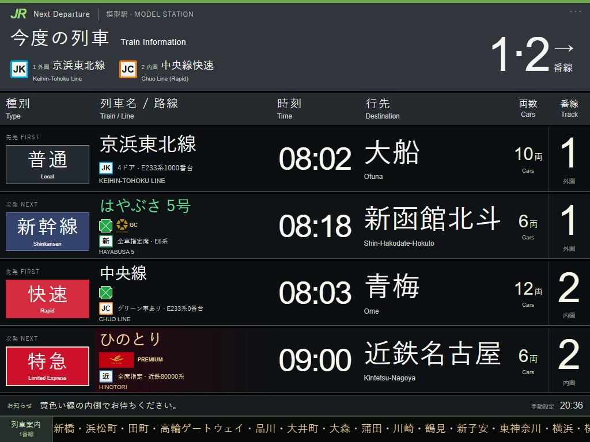

# 模型駅 · N Gauge Web Platform

**简体中文** · [日本語](README.ja.md) · [English](README.en.md)

[在线体验](https://n-gauge-platform-board.clear-seal-8717.chatgpt.site/) · [本地部署教材](docs/DEPLOYMENT.zh-CN.md) · [结构说明](docs/ARCHITECTURE.md) · [MIT 许可](LICENSE)

面向 N 比例铁路模型和 iPad 的日本铁路站台发车标模拟器。以 JR 东日本风格为主体，为私铁和特殊列车提供独立的品牌、种别和设备标识。纯 HTML / CSS / JavaScript，无框架，无需安装前端依赖。



## 功能

- **两个模型站台、四行班次**：1 站台为外圈 R315，2 站台为内圈 R282，各有先发和次发。
- **237 个车辆／服务预设**：按地区 → 类型 → 线路 → 车辆选择。地区包含东日本、西日本、北海道、东海、九州；类型包含新干线、特急、通勤、私铁／地方交通。
- **手动编辑**：车名、号数、出发站、行先、时间、1～30 节编组。右上角隐蔽的 `···` 打开设置。
- **18 类设备、27 个品牌**：Green Car、GranClass、u-seat、PREMIUM CAR、PRiVACE，以及火鸟、岛风、Saphir 踊子等的显示配置；部分品牌使用官方图案，其余使用文字或示意标识。
- **底部滚动案内**：最近待发列车的停站与自由席／指定席／Green 等座席说明，可固定班次、切换模型时钟、调速、暂停或自定义。
- **LCD／LED 外观**：日英主显示、点阵质感、横竖屏适配、浏览器保存和 JSON 设置导出。

## 班次资料的范围

当前发布的是 **V6：237 个预设、425 条代表班次**，参考日固定为 **2026-10-25，星期日，日本时间 JST（UTC+9）**。完整全天班次库仍在整理中，目前已暂停扩展，未纳入本版本。页面不是实时查询，也不会在次日自动更新资料。

| 预设数 | 核对范围 |
|---:|---|
| 117 | 已核对 10/25 当天时刻源或运行日 |
| 95 | 官方现行土休日参考 |
| 15 | 官方每日时刻参考 |
| 4 | 官方观光列车时刻，运行日仍需确认 |
| 2 | 银座／丸之内的官方旧表，现行时间未核实 |
| 2 | 北斗星／超级白鸟，已停运的历史参考 |
| 2 | 湘南／赤城，仅工作日参考，周日不运行 |

具体系列可能混用，真实线路班次不保证由所选车型担当。模型节数独立于实车编组和座席号车；模型 1／2 站台也不表示实际车站番线。完整停站只在已录入资料且号数、方向、种别仍匹配时使用；手填新号数不会联网查询。

详见 [逐项来源与限制](TIMETABLES.md)、[特殊显示考证](SPECIAL-DISPLAYS.md)、[滚动案内考证](SCROLL-RESEARCH.md)。

## 快速开始

安装 Python 3；使用 ZIP 下载源码不需要 Git。以下命令在仓库根目录运行，即同时包含 `README.md` 和 `dist/` 的目录。

```sh
git clone https://github.com/sakual123/N-gauge-web-platform.git
cd N-gauge-web-platform
python -m http.server 8769 --bind 127.0.0.1 --directory dist
```

Windows 的 Python 启动器可使用 `py`，Linux／macOS 通常使用 `python3`。本机打开 **http://127.0.0.1:8769/**。按 `Ctrl+C` 停止。

iPad 使用时，改为 `--bind 0.0.0.0`，连接同一局域网，在 Safari 打开 `http://服务器的局域网IP:8769/`。完整安装、查 IP、排错和 Linux 开机启动步骤见 [中文部署教材](docs/DEPLOYMENT.zh-CN.md)。

## 设置与保存

1. 点击右上角 `···`，选择 1／2 站台，再按地区、类型和线路选择车辆。
2. 选择官方参考班次，或修改固定出发时间、车次、行先和编组。修改自动保存在当前浏览器。
3. 在“滚动停站与座席”中设置停站和座席，在“底部滚动提示”中选择跟随班次、时钟、速度和暂停。
4. 需要备份时使用“导出设置备份”。当前版本没有图形化 JSON 导入按钮。

原有四行和自定义编组会保留；“四行套用默认参考班次”和载入场景会改变当前四行。浏览器保存按访问地址区分：换端口、IP、协议或设备不会自动带走设置。添加到 iPad 主屏幕不等于已经缓存为离线应用；本项目没有 Service Worker。

主显示以日文和英文为主，编辑器目前为中文；三语文档不代表编辑界面已经实现三语切换。

## 开发和文件

使用 Node.js 22 或更新的受支持 LTS 版本运行检查，不需要 `npm install`：

```sh
npm test
```

也可分别执行 `node tools/check-timetable.cjs`、`node tools/check-special.cjs`、`node tools/check-ticker.cjs`。GitHub Actions 在 push 和 pull request 时运行同样的三组检查。

| 文件 | 用途 |
|---|---|
| `dist/index.html`、`styles.css`、`app.js` | 页面、外观、编辑器与保存 |
| `dist/catalog*.js` | 地区、线路和车辆目录 |
| `dist/timetable-*.js` | 固定参考班次、套用逻辑和来源面板 |
| `dist/special-services.js`、`service-ui.js` | 品牌、设备和座席图案 |
| `dist/journey-*.js` | 停站、座席说明和滚动逻辑 |
| `tools/check-*.cjs` | 无第三方依赖的源代码与数据检查 |
| `CATALOG.md`、`TIMETABLES.md` | 预设目录与资料出处 |
| `docs/` | 三语部署教程、结构说明和截图 |

本仓库当前是可独立使用的网页前端。OpenCV／YOLO 识别和 LVGL 硬件显示端尚未实现。

## 贡献与许可

欢迎提交 Issue 和 Pull Request。修改班次时请附官方来源、适用日期、出发站和方向，区分已核对事实、运行日未确认与车型混用。提交前运行检查；界面改动请检查 iPad 横竖屏。

原创代码按 [MIT License](LICENSE) 开源。官方商标、服务名称和图案等第三方素材不属于本项目的 MIT 授权范围，详见 [THIRD_PARTY_NOTICES.md](THIRD_PARTY_NOTICES.md) 和资产来源清单。项目与铁路运营商无隶属或官方认可关系。
